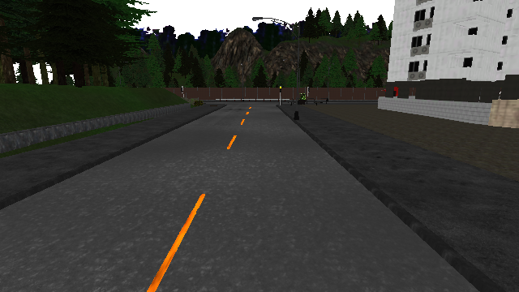

# Vision-Lane-Following

Camera-based lane following in CARLA with reproducible closed-loop evaluation.

전방 RGB 영상에서 차선 중심 waypoint를 예측하고 controller로 차량을 조향합니다. 차선 검출 정확도뿐 아니라 실제 주행의 완주율, 횡방향 오차, 차선 침범, 충돌 및 처리 시간을 평가합니다.

**진행 상태: D1·D2·D3 완료.** CARLA 0.9.16의 고정 차량·전방 RGB·날씨·0.05초 동기 설정을 구현했습니다. 로컬 RTX 3060 Laptop 6GB에서 같은 설정을 두 번 실행해 RGB 40프레임, 카메라 장착 위치와 종료 후 복구를 검증했습니다. 다음 단계는 D4의 이미지·차량 자세 episode logger입니다.

## 시스템과 입력 범위

```text
전방 RGB -> waypoint 5개 -> controller -> steering
```

경로 예측기의 입력은 RGB뿐입니다. 차량 속도 피드백은 저수준 속도 제어와 controller의 속도 의존 계산에 사용할 수 있습니다. 지도, 세계 좌표의 차량 자세와 정답 경로는 라벨 생성 및 평가에 사용합니다. 이를 이용한 정답 waypoint 주행은 camera-only 방법과 구분해 보고합니다.

초기 버전은 고정 차량과 카메라, 분기 없는 직선과 곡선, 다른 차량과 보행자가 없는 조건으로 시작합니다. Waypoint는 목표 차선 중심선을 따라 3·6·9·12·15m 앞의 점이며, 해당 frame의 차량 좌표계에서 m 단위의 `[x, y]`로 표현합니다. 교차로 의사결정과 객체 회피는 초기 범위에 포함하지 않습니다.

## 로컬 CARLA 설치와 실행

저장소 루트의 Windows PowerShell에서 실행합니다. 최초 설치에는 공식 ZIP 다운로드와 압축 해제를 위한 35GiB 이상의 여유 공간이 필요합니다. 프로젝트 `.venv`에 Python 3.12 x64와 해시를 고정한 `carla==0.9.16`을 설치합니다.

```powershell
powershell -NoProfile -ExecutionPolicy Bypass -File scripts/setup_d2.ps1
powershell -NoProfile -ExecutionPolicy Bypass -File scripts/carla_server.ps1 -Action Start
.\.venv\Scripts\python.exe scripts/check_carla_connection.py --timeout 30 --ticks 3
.\.venv\Scripts\python.exe scripts/carla_rgb_probe.py --reuse-current-world --output-dir results/local/carla-rgb-smoke --timeout 60
powershell -NoProfile -ExecutionPolicy Bypass -File scripts/carla_server.ps1 -Action Stop
```

설치 위치는 `carla/CARLA_0.9.16`이고, 같은 ZIP·설치·가상환경을 재사용합니다. 실행 도구는 Town01을 고정하고 TCP 준비를 기다립니다. 연결 검사는 실제 package·API·server 버전이 모두 0.9.16이고 simulation이 진행해야 통과합니다. 상태 확인에는 `carla_server.ps1 -Action Status`를 사용합니다.

로컬 RGB 검사는 이미 시작한 Town01을 재사용합니다. 이번 Windows 배포에서 지도 재로딩 중 서버 종료를 관찰했으므로 `--reuse-current-world`를 지정합니다. 초기화, 복구 절차와 실제 증거는 [D2 실행 기록](docs/ENVIRONMENT_D2.md)에 있습니다.

## D3 수집 설정 검증

[collection_d3.json](configs/collection_d3.json)에 Model3, Town01 spawn index 0, ClearNoon, RGB 640×360·FOV 90°, 전방 Rigid mount와 동기 timestep을 고정했습니다. 실행 도구가 적용된 속성·제어·카메라 장착 위치를 다시 읽고 같은 초기화를 확인합니다.

```powershell
powershell -NoProfile -ExecutionPolicy Bypass -File scripts/carla_server.ps1 -Action Start
.\.venv\Scripts\python.exe scripts/verify_collection.py --validate-only
.\.venv\Scripts\python.exe scripts/verify_collection.py --runs 2 --output-dir results/local/collection-d3
.\.venv\Scripts\python.exe scripts/check_carla_connection.py --ticks 3
powershell -NoProfile -ExecutionPolicy Bypass -File scripts/carla_server.ps1 -Action Stop
```

`--validate-only`는 API 설치 없이 설정을 검사하며 `CONFIG_VALIDATED`를 출력합니다. 실제 검증의 `PASS`에는 RGB·snapshot의 frame/시간 정합, 동일 초기화 signature, owned actor 제거 및 원래 날씨·월드 설정 복구가 필요합니다. 이미 동기 실행 중이거나 다른 차량·보행자·센서가 있으면 시작을 거부합니다.

기존 Town01을 재사용하므로 검증 범위는 설정과 초기화·calibration 재현입니다. Strict physics determinism과 이미지의 pixel 동일성은 검증하지 않았습니다. 자세한 실행과 실제 증거는 [D3 수집 설정 기록](docs/COLLECTION_D3.md)에 있습니다.



## 환경 진단 실행

D1 도구는 Python 표준 라이브러리만 사용합니다. CARLA나 PyTorch 설치 없이 실행할 수 있으며, 패키지는 import하지 않고 설치 metadata만 조사합니다.

Windows PowerShell에서 저장소 루트를 기준으로 실행합니다.

```powershell
py -3.12 scripts/doctor.py
py -3.12 scripts/doctor.py --output results/local/environment.json
```

Windows 진입점은 프로젝트 `.venv`의 Python, `py -3.12`, `python` 순서로 선택합니다. 다른 위치에서 실행할 때도 script 경로를 기준으로 프로젝트 디스크를 조사합니다.

```powershell
powershell -NoProfile -ExecutionPolicy Bypass -File scripts/doctor.ps1 -OutputPath results/local/environment.json
```

이미 준비한 CARLA 패키지를 검사하려면 설치 폴더를 직접 지정합니다.

```powershell
.\.venv\Scripts\python.exe scripts/doctor.py --carla-root carla/CARLA_0.9.16 --strict
```

일반 실행은 환경 조사가 끝나면 종료 코드 `0`을 반환합니다. `--strict`는 Python 호환성, CARLA API 및 명시한 server 패키지의 사전 조건을 확인해 준비가 부족하면 `1`을 반환합니다. 실행·출력 오류는 `2`입니다. 사전 조건 통과도 실제 server 연결이나 GPU 학습 검증을 뜻하지 않습니다. 절대 경로, 사용자 이름, hostname, 인증정보는 JSON에 저장하지 않으며, 머신별 출력은 Git에서 제외합니다.

## 시작 환경

| 항목 | 실제 구성과 확인 |
| --- | --- |
| OS | Windows 11 Pro x64 |
| CPU와 RAM | Intel i7-11800H, 8 cores / 16 threads, RAM 약 64GB |
| GPU | RTX 3060 Laptop, VRAM 6GB |
| 개발 Python | CPython 3.12.7 x64, 프로젝트 `.venv` |
| Simulator와 API | CARLA 0.9.16, 실제 RPC 버전 일치 확인 |
| 로컬 실행 | Town01, Low, off-screen, RGB 640×360 한 개 |

GPU의 VRAM 6GB에서 위 설정의 RGB 20프레임 시험이 통과했습니다. GPU 전체 메모리 사용량은 capture 전후 3,156·3,172MiB였습니다. 짧은 정지 상태의 시험 결과이며 장시간 수집과 학습 성능은 해당 단계에서 측정합니다. 하드웨어 조사는 [D1 환경 기록](docs/ENVIRONMENT_D1.md), 실제 실행은 [D2 기록](docs/ENVIRONMENT_D2.md)에 있습니다.

## 검증

Kaggle T4 두 개에서 작은 모델의 CUDA 학습을 확인했고, 기존 EGL 드라이버를 지정해 CARLA의 off-screen RGB 렌더링을 검증했습니다. Town01, Low, 640×360 카메라 하나에서 20프레임의 정합을 확인했습니다. 정지 상태의 짧은 수집 시험이며 주행 benchmark와 장기 안정성은 후속 단계에서 확인합니다. 환경 차이, 실제 PNG·JSON 및 재현 명령은 [Kaggle CARLA 검증 기록](docs/KAGGLE_CARLA_VERIFICATION.md)에 있습니다.

```powershell
.\.venv\Scripts\python.exe -m unittest discover -s tests -v
```

로컬 검증 123개가 통과했습니다(0 skip). 버전 불일치·서버 누락·설정 검증, RGB frame·timestamp·카메라 장착 정합, 불완전한 복구, actor 설명 캐시, ZIP 무결성·경로 검사, Windows 포트 충돌과 소유하지 않은 process 종료 거부를 포함합니다. GitHub Actions는 Windows와 Linux 검증을 구성했으나 계정의 Actions 사용 제한으로 원격 CI는 실행되지 않았습니다.

## 프로젝트 문서

- [일별 로드맵](docs/ROADMAP.md): 핵심 D1~D56, 선택 연구 D57~D84.
- [프로젝트 범위](docs/PROJECT_SCOPE.md): 입력, 출력, 라벨 및 비교 원칙.
- [D1 환경 기록](docs/ENVIRONMENT_D1.md): 실제 호스트 조사와 D2 준비 상태.
- [D2 환경과 실행](docs/ENVIRONMENT_D2.md): 고정 버전, 설치·실행·복구 명령과 실제 로컬 JSON·PNG.
- [D3 수집 설정](docs/COLLECTION_D3.md): 차량·카메라·동기 config, 반복 검증·복구와 실제 RGB 증거.
- [Kaggle CARLA 검증](docs/KAGGLE_CARLA_VERIFICATION.md): 실제 T4 학습, Vulkan, CARLA RGB 실행 결과와 재현 방법.
- [진행 기록](docs/progress.md): 완료 근거와 다음 작업.

대규모 데이터, simulator 배포 파일, checkpoint 및 머신별 실행 출력은 Git에 넣지 않습니다. 이후 dataset snapshot과 모델 artifact는 버전 및 checksum으로 추적합니다.
