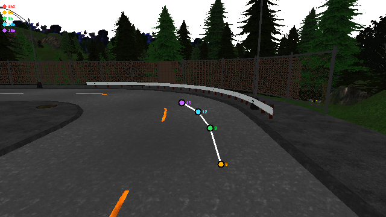
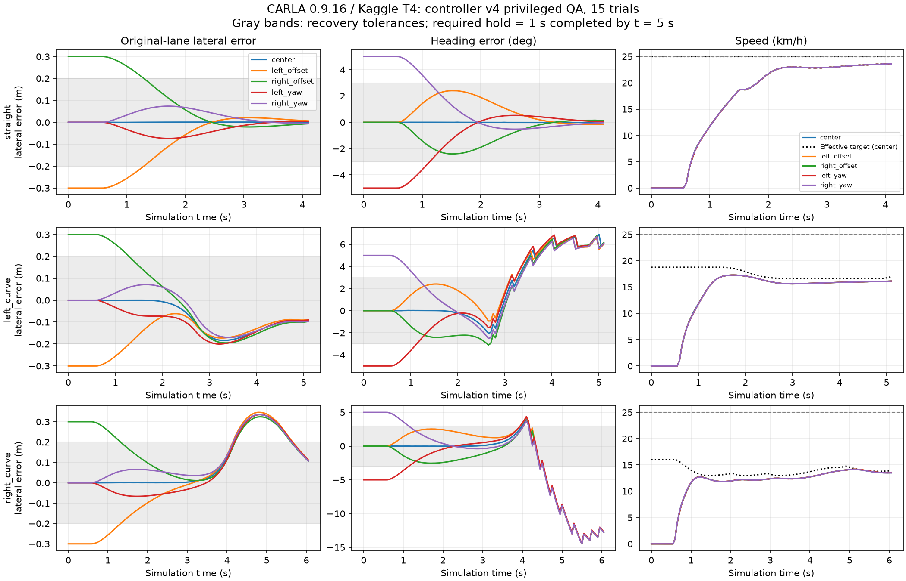

# Vision-Lane-Following

Camera-based lane following in CARLA with reproducible closed-loop evaluation.

전방 RGB 영상에서 차선 중심 waypoint를 예측하고 controller로 차량을 조향합니다. 차선 검출 정확도뿐 아니라 실제 주행의 완주율, 횡방향 오차, 차선 침범, 충돌 및 처리 시간을 평가합니다.

**진행 상태: D1~D10 완료.** CARLA 0.9.16의 수집·경로·라벨 계약과 Pure Pursuit controller를 구현했습니다. 기존 Kaggle T4 notebook의 version 11에서 Town01 직선·좌곡선·우곡선의 15조건 주행·정지와 12개 초기 편차 복구를 검증했습니다. 실제 1,540개 주행 frame·RGB 105장, 전체 다운로드의 CPU 재검증과 손상·지도 검사가 모두 통과했습니다. 다음 단계는 D11 OpenCV B0 waypoint 생성입니다.

## 시스템과 입력 범위

```text
전방 RGB -> waypoint 5개 -> controller -> steering
```

경로 예측기의 입력은 RGB뿐입니다. 차량 속도 피드백은 저수준 속도 제어와 controller의 속도 의존 계산에 사용할 수 있습니다. 지도, 세계 좌표의 차량 자세와 정답 경로는 라벨 생성 및 평가에 사용합니다. 이를 이용한 정답 waypoint 주행은 camera-only 방법과 구분해 보고합니다.

초기 버전은 고정 차량과 카메라, 분기 없는 직선과 곡선, 다른 차량과 보행자가 없는 조건으로 시작합니다. Waypoint는 목표 차선 중심선을 따라 3·6·9·12·15m 앞의 점이며, 해당 frame의 차량 좌표계에서 m 단위의 `[x, y]`로 표현합니다. 교차로 의사결정과 객체 회피는 초기 범위에 포함하지 않습니다.

## 로컬 CARLA 설치와 실행

저장소 루트의 Windows PowerShell에서 실행합니다. 최초 설치에는 공식 ZIP 다운로드와 압축 해제를 위한 35GiB 이상의 여유 공간이 필요합니다. 프로젝트 `.venv`에 Python 3.12 x64와 해시를 고정한 `carla==0.9.16`을 설치합니다.

```powershell
powershell -NoProfile -ExecutionPolicy Bypass -File scripts/setup_d2.ps1
powershell -NoProfile -ExecutionPolicy Bypass -File scripts/carla_server.ps1 -Action Start
.\.venv\Scripts\python.exe scripts/check_carla_connection.py --timeout 30 --ticks 3
.\.venv\Scripts\python.exe scripts/carla_rgb_probe.py --reuse-current-world --output-dir results/local/carla-rgb-smoke --timeout 60
powershell -NoProfile -ExecutionPolicy Bypass -File scripts/carla_server.ps1 -Action Stop
```

설치 위치는 `carla/CARLA_0.9.16`이고, 같은 ZIP·설치·가상환경을 재사용합니다. 실행 도구는 Town01을 고정하고 TCP 준비를 기다립니다. 연결 검사는 실제 package·API·server 버전이 모두 0.9.16이고 simulation이 진행해야 통과합니다. 상태 확인에는 `carla_server.ps1 -Action Status`를 사용합니다.

로컬 RGB 검사는 이미 시작한 Town01을 재사용합니다. 이번 Windows 배포에서 지도 재로딩 중 서버 종료를 관찰했으므로 `--reuse-current-world`를 지정합니다. 초기화, 복구 절차와 실제 증거는 [D2 실행 기록](docs/ENVIRONMENT_D2.md)에 있습니다.

## D3 수집 설정 검증

[collection_d3.json](configs/collection_d3.json)에 Model3, Town01 spawn index 0, ClearNoon, RGB 640×360·FOV 90°, 전방 Rigid mount와 동기 timestep을 고정했습니다. 실행 도구가 적용된 속성·제어·카메라 장착 위치를 다시 읽고 같은 초기화를 확인합니다.

```powershell
powershell -NoProfile -ExecutionPolicy Bypass -File scripts/carla_server.ps1 -Action Start
.\.venv\Scripts\python.exe scripts/verify_collection.py --validate-only
.\.venv\Scripts\python.exe scripts/verify_collection.py --runs 2 --output-dir results/local/collection-d3
.\.venv\Scripts\python.exe scripts/check_carla_connection.py --ticks 3
powershell -NoProfile -ExecutionPolicy Bypass -File scripts/carla_server.ps1 -Action Stop
```

`--validate-only`는 API 설치 없이 설정을 검사하며 `CONFIG_VALIDATED`를 출력합니다. 실제 검증의 `PASS`에는 RGB·snapshot의 frame/시간 정합, 동일 초기화 signature, owned actor 제거 및 원래 날씨·월드 설정 복구가 필요합니다. 이미 동기 실행 중이거나 다른 차량·보행자·센서가 있으면 시작을 거부합니다.

기존 Town01을 재사용하므로 검증 범위는 설정과 초기화·calibration 재현입니다. Strict physics determinism과 이미지의 pixel 동일성은 검증하지 않았습니다. 자세한 실행과 실제 증거는 [D3 수집 설정 기록](docs/COLLECTION_D3.md)에 있습니다.


## D4 에피소드 기록과 D5 데이터 계약

RGB PNG, SHA-256, frame·시간, 같은 snapshot의 차량 자세·속도·가속도와 camera transform을 저장합니다. 예상 frame 수와 적용·cleanup 검증을 모두 만족한 에피소드만 `COMPLETE`가 되며, 별도 validator가 디스크에서 이미지와 기록을 다시 검사합니다. 기존 출력은 덮어쓰지 않습니다.

실제 Town01 지도에서 고정한 spawn 0과 4의 35m 경로를 조사했습니다. 동일 경로의 두 에피소드는 train에 함께 배정하고, 떨어진 경로의 에피소드를 dev로 배정해 **train 120장/dev 60장**을 확보했습니다. Route·episode·scene group 단위로 분할하고 75m 공간 buffer를 검사합니다. 실제 경로와 차량 위치를 포함한 train/dev 최소 거리는 약 220.75m입니다. 같은 경로를 양쪽에 넣는 오류, PNG 손상과 기존 데이터 덮어쓰기도 거부하는 것을 확인했습니다.

```powershell
# 실제 수집에는 먼저 CARLA 서버를 시작합니다.
.\.venv\Scripts\python.exe scripts/collect_episode.py --route-id town01_train_p000 --episode-id my_train_01
.\.venv\Scripts\python.exe scripts/validate_episode.py results/local/dataset-d4-smoke-v1/my_train_01

# 아래 manifest 재검증은 기존 로컬 수집 결과를 사용하며 CARLA가 필요하지 않습니다.
.\.venv\Scripts\python.exe scripts/build_split_manifest.py --episodes results/local/dataset-d4-smoke-v1/train_smoke_01 results/local/dataset-d4-smoke-v1/train_smoke_02 results/local/dataset-d4-smoke-v1/dev_smoke_01 --assignments configs/split_assignments_d5.json --output results/local/dataset-d4-smoke-v1/split_manifest.csv
```

이 D4/D5 데이터는 로컬 RTX 3060 Laptop 6GB에서 수집한 정지 상태의 짧은 logger·split 시험이며, 학습 pilot은 D13에 수집합니다. 원본 frame은 계속 `NOT_GENERATED`·`null`로 보존합니다. D6 라벨은 원본을 수정하지 않고 별도 sidecar에 생성합니다. Town02 final test는 예약만 했으며 미수집·미검증 상태입니다. 기록 구조와 재현 순서는 [D4 logger](docs/EPISODE_LOGGER_D4.md), 좌표·라벨·분할 규칙은 [D5 데이터 계약](docs/DATA_CONTRACT_D5.md), 후속 평가 구현 기준은 [평가 명세 초안](docs/EVALUATION_SPEC_D5.md)에 있습니다.

## D6 waypoint와 D7 Week 1 정합 게이트

2026-10-08 Kaggle T4에서 Town01 직선·좌곡선·우곡선을 각각 60 frame 수집했습니다. 기존 ID `dongmyungpark/vlf-carla-rgb-smoke-20261005`, 제목 `VLF CARLA RGB smoke 20261005`의 **version 4**를 실행했으며 새 notebook을 만들지 않았습니다. 이번 native rendering은 Kaggle에서 수행하고 로컬 GPU는 사용하지 않았습니다. Bootstrap·원격 게이트·전체 다운로드의 CPU 재검증이 모두 PASS하고 소유 server 종료를 확인했습니다. 원본 source와 label SHA-256도 원격 결과와 일치했습니다.

Curve 타깃은 dense lane-centerline XYZ polyline 길이를 누적하고 0.25m anchor로 보간한 physical arc를 사용합니다. CARLA `next(d)` 인수와 실제 차선 중심선 거리를 같게 취급하지 않으며 analytic arc 정확도를 주장하지 않습니다. 원본 RGB·pose·`NOT_GENERATED` 상태는 유지하고 고정 목표 route의 `GENERATED` 라벨을 새 sidecar에 저장합니다.

실제 원격 결과는 **3 episodes·180 RGB frames·900 waypoint points**, frame당 `5 × 2` m 좌표입니다. 모든 frame에서 다섯 점이 camera 전방이고 네 점이 영상 안에 보였습니다. 3m 점은 영상 밖의 원래 UV를 보존했으며 clamp하지 않았습니다. 같은 callback의 BGRA pixel witness와 저장 RGB를 전체 180 frame에서 검증했습니다. Actor 좌표 roundtrip 최대 오차는 약 `8.66e-12m`, camera/world roundtrip은 `7.29e-7m` 미만입니다. 이는 정지 geometry QA이며 학습용 주행 데이터나 lane-following 성능값이 아닙니다.

Version 3에서 세 번째 case의 weather readback이 실패한 기록을 보존했습니다. Weather 적용과 복구는 엄격한 값 비교를 유지하며 최대 2초 동안 readback을 재시도하도록 수정했고 version 4에서 전체 실행을 통과했습니다. 재현과 판정 기준은 [D6 라벨·overlay](docs/WAYPOINT_LABELS_D6.md), [D7 게이트](docs/WEEK1_GATE_D7.md), 실제 결과는 [D6/D7 요약](docs/evidence/carla_week1_d6_d7_2026-10-08_summary.json)과 [weather 실패 기록](docs/evidence/carla_week1_d6_d7_2026-10-08_weather_failure.json)에 정리합니다.



[직선 overlay](docs/evidence/carla_week1_d6_d7_2026-10-08_straight_overlay.png)와 [우곡선 overlay](docs/evidence/carla_week1_d6_d7_2026-10-08_right_curve_overlay.png)도 보존합니다. Overlay는 visible 6/9/12/15m 점을 표시합니다.

다운로드된 `week1` 전체 directory를 보존한 뒤 CPU에서 다시 읽어 3개 episode·180 frame 정합을 확인했습니다. 9개 변조 QA도 예상한 실패를 거부했고, 외부 JSON Schema 검사는 raw frame 180개와 derived label 180개에서 오류가 없었습니다. 아래 명령으로 동일 artifact를 재검증할 수 있으며 CARLA server와 GPU를 요구하지 않습니다.

```powershell
.\.venv\Scripts\python.exe scripts/verify_week1.py --manifest results/local/kaggle-week1-output-v4/week1/week1_manifest.json --output results/local/week1-v4-cpu-gate.json
```

Moving training pilot은 D13, 전체 주행 평가기는 D14이며 Town02는 아직 사용하지 않았습니다.

## D8 controller와 D9·D10 주행·복귀

Pure Pursuit와 nominal 상한 25km/h의 PI 속도 제어를 구현했습니다. 같은 다섯 waypoint의 preview 곡률로 곡선 진입 전 목표 속도를 낮춥니다. Native wheel world-cm 좌표와 측정 pose로 wheelbase·rear axle·전륜 간격·최대 조향각을 계산합니다. Controller v4는 actor-origin 경로를 따르는 원 기하로 rear curvature를 계산하고, 가상 중앙 조향각을 CARLA의 안쪽 전륜 각도로 Ackermann 변환합니다. 원래 waypoint 라벨을 유지하며 lookahead, 조향 변화율 제한, 곡률 기반 속도 계획, 속도 포화와 antiwindup을 설정과 진단 로그에 기록합니다.

Town01의 직선·좌곡선·우곡선마다 중앙 상태, 횡편차 ±0.3m, 방향 편차 ±5°의 **15개 조건**을 검사합니다. 목표 차선을 처음 정한 route로 유지하며, 동일 frame의 RGB·pose·GT label에서 만든 명령이 다음 frame에 적용됐는지 readback합니다. 복귀 기준은 횡오차 ≤0.2m·방향오차 ≤3°를 연속 1초 유지하고 5초 안에 그 유지 구간을 끝내는 것입니다. Collision/lane-invasion sensor, 차체 bounding box의 차선 여유와 종료 후 이벤트도 확인합니다.

**D8~D10 gate PASS:** 기존 Kaggle notebook의 version 11, T4에서 15조건을 모두 통과했습니다. 초기 편차 복구 12개는 simulation 2.15~2.35초에 완료했고, 주행·감속·주차의 차체 최소 차선 여유는 0.24783m로 0.15m 기준을 만족했습니다. 충돌·차선 침범·callback 오류는 0건이며 소유 actor와 서버 종료도 확인했습니다. 전체 1,540 frame·RGB 105장을 다운로드해 CPU gate, 16개 손상 검사, 실제 Map의 6,980개 차체 모서리 검사를 통과했습니다. Source hash와 notebook ID·제목도 일치합니다.

초기 spawn, 곡선 정지, 제어 전달, 복귀 유지, Ackermann 입력과 actor-origin 계산의 실패 증거를 보존하고 수정했습니다. 35m route의 마지막 frame에도 15m의 label horizon을 확보하도록 종료 기준은 reference 19m입니다. 초기 편차는 catalog 시작점의 접근 구간에서 적용했습니다. 이번 결과는 GT waypoint를 사용하는 짧은 privileged controller 개발 QA이며 camera-only 모델이나 학습 pilot은 이후 단계입니다.



회색 band는 초기 복귀 유지 기준이며 전체 곡선 주행의 heading 상한이 아닙니다. 상세 판정과 15조건 CSV는 [D9/D10 검증 기록](docs/DRIVING_RECOVERY_D9_D10.md), 실제 source·gate·정리 결과는 [증거 요약](docs/evidence/carla_driving_d8_d10_2026-10-08_summary.json)에 있습니다.

```powershell
# 실행 중인 전용 Town01 서버에서 15개 조건을 수집합니다.
.\.venv\Scripts\python.exe scripts/run_driving_pipeline.py --output-dir results/local/driving-new-run

# 원본 artifacts의 CPU 재검증에는 CARLA 서버와 GPU가 필요하지 않습니다.
.\.venv\Scripts\python.exe scripts/verify_driving.py --manifest results/local/kaggle-d10-output-v11/driving/driving_manifest.json --output results/local/driving-v11-cpu-gate.json
.\.venv\Scripts\python.exe scripts/audit_driving.py --native results/local/kaggle-d10-output-v11 --output results/local/driving-v11-cpu-negative.json
.\.venv\Scripts\python.exe scripts/audit_driving_map.py --native results/local/kaggle-d10-output-v11/driving --output results/local/driving-v11-cpu-map-gate.json
```

구현과 좌표·속도 제어는 [D8 controller](docs/controller_d8.md), 고정 route 주행과 복귀 판정·기존 Kaggle 재사용은 [D9/D10 검증](docs/DRIVING_RECOVERY_D9_D10.md)에 설명합니다.

## 환경 진단 실행

D1 도구는 Python 표준 라이브러리만 사용합니다. CARLA나 PyTorch 설치 없이 실행할 수 있으며, 패키지는 import하지 않고 설치 metadata만 조사합니다.

Windows PowerShell에서 저장소 루트를 기준으로 실행합니다.

```powershell
py -3.12 scripts/doctor.py
py -3.12 scripts/doctor.py --output results/local/environment.json
```

Windows 진입점은 프로젝트 `.venv`의 Python, `py -3.12`, `python` 순서로 선택합니다. 다른 위치에서 실행할 때도 script 경로를 기준으로 프로젝트 디스크를 조사합니다.

```powershell
powershell -NoProfile -ExecutionPolicy Bypass -File scripts/doctor.ps1 -OutputPath results/local/environment.json
```

이미 준비한 CARLA 패키지를 검사하려면 설치 폴더를 직접 지정합니다.

```powershell
.\.venv\Scripts\python.exe scripts/doctor.py --carla-root carla/CARLA_0.9.16 --strict
```

일반 실행은 환경 조사가 끝나면 종료 코드 `0`을 반환합니다. `--strict`는 Python 호환성, CARLA API 및 명시한 server 패키지의 사전 조건을 확인해 준비가 부족하면 `1`을 반환합니다. 실행·출력 오류는 `2`입니다. 사전 조건 통과도 실제 server 연결이나 GPU 학습 검증을 뜻하지 않습니다. 절대 경로, 사용자 이름, hostname, 인증정보는 JSON에 저장하지 않으며, 머신별 출력은 Git에서 제외합니다.

## 시작 환경

| 항목 | 실제 구성과 확인 |
| --- | --- |
| OS | Windows 11 Pro x64 |
| CPU와 RAM | Intel i7-11800H, 8 cores / 16 threads, RAM 약 64GB |
| GPU | RTX 3060 Laptop, VRAM 6GB |
| 개발 Python | CPython 3.12.7 x64, 프로젝트 `.venv` |
| Simulator와 API | CARLA 0.9.16, 실제 RPC 버전 일치 확인 |
| 로컬 실행 | Town01, Low, off-screen, RGB 640×360 한 개 |

GPU의 VRAM 6GB에서 위 설정의 RGB 20프레임 시험이 통과했습니다. GPU 전체 메모리 사용량은 capture 전후 3,156·3,172MiB였습니다. 짧은 정지 상태의 시험 결과이며 장시간 수집과 학습 성능은 해당 단계에서 측정합니다. 하드웨어 조사는 [D1 환경 기록](docs/ENVIRONMENT_D1.md), 실제 실행은 [D2 기록](docs/ENVIRONMENT_D2.md)에 있습니다.

## 검증

Kaggle T4 두 개에서 작은 모델의 CUDA 학습을 확인했고, 기존 EGL 드라이버를 지정해 CARLA의 off-screen RGB 렌더링을 검증했습니다. Town01, Low, 640×360 카메라 하나에서 20프레임의 정합을 확인했습니다. 정지 상태의 짧은 수집 시험이며 주행 benchmark와 장기 안정성은 후속 단계에서 확인합니다. 환경 차이, 실제 PNG·JSON 및 재현 명령은 [Kaggle CARLA 검증 기록](docs/KAGGLE_CARLA_VERIFICATION.md)에 있습니다.

```powershell
.\.venv\Scripts\python.exe -m unittest discover -s tests -v
```

최신 로컬 단위·통합 검증 **450개가 통과했습니다(0 skip)**. 기존 수집·라벨·split 검사와 함께 wheel geometry, actor-origin 원 기하와 전륜 간격 기반 Ackermann 변환, 좌우 조향·속도 제어, 곡률 preview 속도 계획, 동기 batch 응답과 frame별 제어 적용, 고정 경로 추적·복귀 유지, 실제 정지 후 주차, 늦은 센서 이벤트와 callback 처리 종료, 초기 spawn 정렬, 기존 Kaggle 재사용과 bundle/bootstrap, CPU 손상 검사·지도 모서리 audit를 포함합니다. 기존 D4/D5·D6/D7의 실제 결과는 그대로 보존합니다. GitHub Actions는 Windows와 Linux 검증을 구성했으나 계정의 Actions 사용 제한으로 원격 CI는 실행되지 않았습니다.

## 프로젝트 문서

- [일별 로드맵](docs/ROADMAP.md): 핵심 D1~D56, 선택 연구 D57~D84.
- [프로젝트 범위](docs/PROJECT_SCOPE.md): 입력, 출력, 라벨 및 비교 원칙.
- [D1 환경 기록](docs/ENVIRONMENT_D1.md): 실제 호스트 조사와 D2 준비 상태.
- [D2 환경과 실행](docs/ENVIRONMENT_D2.md): 고정 버전, 설치·실행·복구 명령과 실제 로컬 JSON·PNG.
- [D3 수집 설정](docs/COLLECTION_D3.md): 차량·카메라·동기 config, 반복 검증·복구와 실제 RGB 증거.
- [D4 episode logger](docs/EPISODE_LOGGER_D4.md): 같은 frame의 이미지·자세 저장, 완료 조건·파일 검사와 실제 180장 수집.
- [D5 데이터 계약](docs/DATA_CONTRACT_D5.md): 고정 route, ego waypoint schema, 장면 단위 train/dev 분할과 final 예약.
- [D5 평가 명세](docs/EVALUATION_SPEC_D5.md): 공통 controller, 주행 지표·종료 규칙·provisional threshold 및 후속 freeze.
- [D6 waypoint 라벨](docs/WAYPOINT_LABELS_D6.md): fixed-route physical arc, actor-origin 라벨 sidecar, 원본 보존과 동일 frame overlay; [실제 geometry route](configs/routes_d6_geometry.json).
- [D7 Week 1 게이트](docs/WEEK1_GATE_D7.md): native 3-case 기하·색상 검증, 기존 Kaggle 재사용 및 CPU 재검증.
- [D8 Pure Pursuit와 속도 제어](docs/controller_d8.md): native wheel 측정, rear axle, lookahead·조향 제한과 PI antiwindup.
- [D9/D10 주행·복귀 검증](docs/DRIVING_RECOVERY_D9_D10.md): 고정 목표 route, 15개 조건, 센서·차체 검사와 CPU 재검증.
- [Kaggle CARLA 검증](docs/KAGGLE_CARLA_VERIFICATION.md): 실제 T4 학습, Vulkan, CARLA RGB 실행 결과와 재현 방법.
- [진행 기록](docs/progress.md): 완료 근거와 다음 작업.

대규모 데이터, simulator 배포 파일, checkpoint 및 머신별 실행 출력은 Git에 넣지 않습니다. 이후 dataset snapshot과 모델 artifact는 버전 및 checksum으로 추적합니다.
