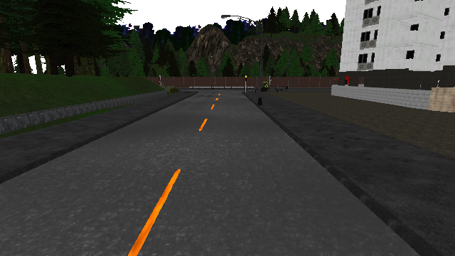
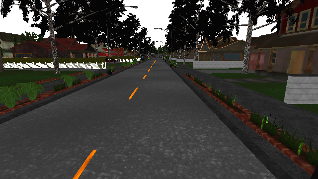

# D4 이미지·차량 자세 episode logger

실제 날짜: **2026-10-07 (Asia/Seoul)**. **D4 gate PASS**: 로컬 CARLA 0.9.16에서 에피소드 3개를 수집하고 RGB 180장과 같은 frame의 차량 snapshot 180개를 저장·재검증했다. 수집마다 owned actor를 제거하고 원래 날씨·비동기 월드 설정을 복구했다. [실제 요약과 실패 검사](evidence/carla_dataset_d4_d5_2026-10-07_summary.json)에 근거한다.

## 기록과 완료 조건

[collection_d4.json](../configs/collection_d4.json)은 D3 차량·카메라·날씨·0.05초 설정을 유지하고 warmup 30프레임 뒤 60프레임을 저장한다. 차량은 brake=1, hand_brake=true인 정지 상태다. 이 데이터는 logger와 데이터 계약을 확인하는 짧은 smoke dataset이다. 학습용 주행 pilot은 D13 작업이다.

[capture.py](../carla_tools/capture.py)의 sensor callback은 용량 8의 queue에 비동기로 이미지를 넣는다. Queue overflow, timeout, 미래 frame, 누락, 중복 또는 연속성 오류가 발생하면 capture를 실패 처리한다. 각 tick에서 world snapshot의 frame·시간을 RGB의 frame·시간과 대조하고 snapshot의 차량 자세·속도·각속도·가속도를 읽는다. Camera image transform으로 차량에 대한 Rigid mount를 검사한다. 제어 값은 같은 world frame의 client cache readback이며 `control_source`로 출처를 표시한다.

```text
episode_id/
  episode.json           # 설정·calibration·route·상태·cleanup
  frames.jsonl           # frame당 RGB 경로·hash와 snapshot 상태
  images/00000000.png     # 실제 frame 번호, RGB 640×360
```

[episode.py](../carla_tools/episode.py)는 같은 volume의 임시 파일을 fsync한 뒤 독점적으로 PNG를 공개하고 JSONL 행을 추가한다. Metadata는 `RUNNING`으로 시작하며 다음 조건을 모두 만족해야 `COMPLETE`가 된다.

- 예정된 모든 이미지와 frame 행을 저장했다.
- 실제 적용 확인과 capture가 성공했다.
- 센서 정지, owned actor 제거, 설정·날씨 복구가 성공했다.
- 저장된 데이터를 다시 읽어 독립 무결성 검사를 통과했다.

실패하거나 중단된 에피소드는 `FAILED` 또는 `RUNNING`으로 남으며 완료 데이터로 사용할 수 없다. Capture CLI는 기존 destination을 빈 폴더까지 포함해 거부한다. 재실행 시 기존 에피소드를 덮어쓰지 않고 새 episode ID를 지정한다. 이것은 Kaggle 노트북 ID를 새로 만드는 동작과 별개이며 기존 Kaggle 노트북 재사용 원칙은 유지한다.

Validator는 strict JSON, frame·시간 연속성, 설정 hash, PNG CRC·압축 데이터·크기·SHA-256, image 경로, 자세와 4×4 transform 일치, camera mount와 calibration, frame 수 및 orphan image를 검사한다. PNG 일부만 바꾸거나 cleanup이 실패해도 완료 데이터로 판정하지 않는다.

## 재실행

저장소 루트 PowerShell에서 기존 설치와 Town01을 사용한다. Map을 재로딩하지 않는다. Route catalog는 [routes_d5.json](../configs/routes_d5.json)에 실제 지도 조사 결과를 고정했으며, capture 직전에 서버의 topology와 OpenDRIVE hash를 다시 대조한다.

```powershell
powershell -NoProfile -ExecutionPolicy Bypass -File scripts/carla_server.ps1 -Action Start
.\.venv\Scripts\python.exe scripts/survey_routes.py --validate-only
.\.venv\Scripts\python.exe scripts/collect_episode.py --route-id town01_train_p000 --episode-id my_train_01 --validate-only
.\.venv\Scripts\python.exe scripts/collect_episode.py --route-id town01_train_p000 --episode-id my_train_01
.\.venv\Scripts\python.exe scripts/validate_episode.py results/local/dataset-d4-smoke-v1/my_train_01
.\.venv\Scripts\python.exe scripts/check_carla_connection.py --ticks 3
powershell -NoProfile -ExecutionPolicy Bypass -File scripts/carla_server.ps1 -Action Stop
```

`--validate-only`는 CARLA를 import하거나 데이터를 생성하지 않으며 `CONFIG_VALIDATED`만 반환한다. 실제 `PASS`와 구분한다. Episode ID와 dataset version은 영문·숫자·밑줄·하이픈으로 구성한 1~64자 portable ID다. 기본 출력은 `results/local/dataset-d4-smoke-v1/`이고 Git에서 제외한다. 다른 dataset version을 사용할 때는 `--dataset-version`과 `--output-root`를 함께 지정한다.

## 실제 결과

| Episode | Route / spawn | Frame | RGB·snapshot | Cleanup·disk validation |
| --- | --- | --- | --- | --- |
| train_smoke_01 | town01_train_p000 / 0 | 141695~141754 | 60 / 60 | PASS |
| train_smoke_02 | town01_train_p000 / 0 | 219425~219484 | 60 / 60 | PASS |
| dev_smoke_01 | town01_dev_p004 / 4 | 222576~222635 | 60 / 60 | PASS |

Capture loop는 PNG 변환·디스크 저장·수집 검사를 포함하고 warmup을 제외해 각각 약 3.370·3.567·3.758초였다. 각 에피소드의 simulation 진행은 3초다. 주행·학습 모델 성능이나 장시간 안정성 측정으로 해석하지 않는다. 종료 후 [RPC 3 tick](evidence/carla_dataset_d4_d5_2026-10-07_connection_after.json)이 PASS였고, 이번 작업의 소유 서버를 종료한 뒤 상태 파일과 port 2000·2001 listener가 없어졌다.

[Metadata 예시](evidence/carla_dataset_d4_d5_2026-10-07_episode_example.json)와 각 에피소드의 첫·마지막 원본 행([train 1](evidence/carla_dataset_d4_d5_2026-10-07_train_smoke_01_frames.json), [train 2](evidence/carla_dataset_d4_d5_2026-10-07_train_smoke_02_frames.json), [dev](evidence/carla_dataset_d4_d5_2026-10-07_dev_smoke_01_frames.json))을 저장했다. 행의 image 경로·hash는 로컬 원본을 가리킨다. 이 발췌를 완전한 episode로 검증할 수는 없다. 전체 180장과 JSONL은 로컬 출력에 보존하고 아래 두 PNG만 검토용으로 Git에 넣는다.





Waypoint는 아직 생성하지 않았다. 모든 행에 `label_state="NOT_GENERATED"`, `label=null`을 기록하며 0 좌표나 가짜 정답을 넣지 않는다. [D5 데이터 계약](DATA_CONTRACT_D5.md)에 따라 D6에서 목표 차선 중심선의 3·6·9·12·15m 지점을 해당 frame의 차량 좌표계로 변환하고 overlay를 검증한다.
