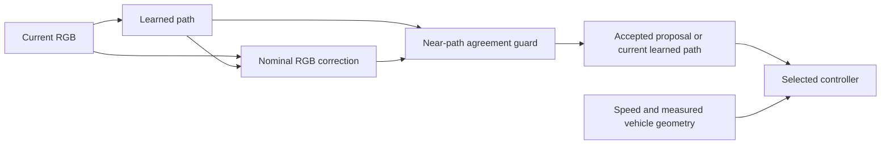

# Controller and environment development comparison

This workflow compares control settings while keeping the learned RGB model,
nominal camera interpretation and evaluation definitions fixed. It then checks
appearance fine-tuning candidates with the selected controller. All decisions
use development routes and conditions; reserved final evaluation stays unopened.

## Control and camera contracts

`carla_tools.controller_study` wraps the existing measured vehicle geometry and
speed controller. It supports Pure Pursuit, optional steering smoothing and a
Stanley alternative. Waypoints retain the actor-origin, x-forward, y-right,
metre convention. Stanley converts the predicted actor path to the corresponding
measured front-axle path before computing cross-track and heading terms.

The comparison keeps target speed, simulation timestep, native steering
normalization and limits explicit. Controllers reset before each episode. Gain
and lookahead choices, smoothing and method identities are part of the frozen
configuration rather than inferred from an artifact filename.

Development environment changes include noon cloud and soft rain, small camera
yaw changes and a small mounting-height change. Camera pitch, difficult rain,
sunset and final towns are reserved. Physical camera settings are applied to the
simulator and checked against recorded transforms. B0 and M1 retain their fixed
nominal perception calibration; the actual shifted mount and reference route
are used for auditing and metrics, not passed to perception.

## Staged development search

`freeze_development_protocol` declares the candidate grid, paired route states,
possible stage plans and decision rules before execution. The default study has
six controller configurations and four stages:

1. Screen all configurations on the same development starts and perturbations.
2. Compare the shortlisted alternative with the incumbent on another start.
3. Confirm the proposal and compare B0 using the same proposed controller.
4. Run the declared development environment matrix, preserving failed drives.

Arm order alternates between paired states. Each earlier-stage decision is
saved before obtaining later-stage observations. Configuration confirmation is
still development selection; the short correlated routes and repeated simulator
configuration do not create an independent final test.

Prepare a source-bound bundle with
`scripts.prepare_kaggle_development_study.prepare_development_study`. Preparation
does not contact Kaggle or submit a job. It requires existing notebook metadata,
a frozen route/protocol pair, a versioned training archive and the exact
checkpoint member/hash. Submission must separately verify the existing private
notebook's identity and access. Reuse its ID and title, and keep credentials out
of source, command arguments and artifacts.

Run the native study inside the approved simulator/GPU environment:

```bash
python scripts/run_development_study.py \
  --routes /path/to/development_routes.json \
  --protocol /path/to/frozen_protocol.json \
  --checkpoint /path/to/refined_checkpoint.pt \
  --output-dir /path/to/new-study-output \
  --device cuda
```

The CLI defaults to CPU. A local CPU invocation can validate imports and
prediction contracts; the native command still requires an actual CARLA server.
It should not be interpreted as a simulator-free validation command.

## Controlled learning improvement

[Appearance fine-tuning](development-training.md) starts both the continuation
control and appearance-robust candidate from the same complete checkpoint. The
training IDs, initialization, update budget, seed policy and common development
images are paired. Appearance augmentation preserves image geometry and metre
labels. Development evidence determines the actual private experiment protocol.

Checkpoint and representative-seed selection finish before full-development
metrics or native confirmation results are used. Primary training checkpoints
and runtime-compatible exports are byte-distinct files. Their original hashes
are retained separately and exact tensor equality must be audited; an offline
metric report is never rewritten to claim the export's file identity.

## Guard the RGB correction proposal

`carla_tools.guarded_path_correction` compares the current learned path with
the nominal RGB correction proposal. A bounded disagreement check on the near
waypoints decides whether to accept the proposal or retain the current learned
path. The guard uses no reference labels, native pose, route or actual camera
calibration, and it does not reuse a preceding frame's path. The original
correction and the guard leave the far waypoints unchanged.

Freeze the guard configuration from development evidence before subsequent
native comparison. Recorded trajectories can diagnose a harmful proposal and
measure rejected useful corrections; applying a guard to those records does not
simulate the different vehicle trajectory that would result. Actual closed-loop
comparison remains necessary.



The protocol records preprocessing separately for every arm. A model-only
control with guarded correction isolates the fusion change from retraining;
continuation and appearance-trained candidates share that same guard. Original
and guarded predictors with the same weights have distinct runtime identities.

## Final development regression and selection

`scripts/run_development_final.py` runs two declared development matrices:
nominal driving and environment shifts. The compared pipelines are the original
model/controller/preprocessing, the original model with the candidate controller
and preprocessing, the two representative fine-tuned models with that same
candidate configuration, and B0 as a common controller reference. Preparing these runs uses
`scripts.prepare_kaggle_development_final.prepare_development_final`.

`select_development_pipeline` verifies the complete paired episodes and common
offline evaluation before ranking eligible learned pipelines. The declared score
is half the nominal equal-episode mean lateral error plus half the equally
weighted means of the five development shifts. The repeated clear robustness
drive remains checked and reported but is not scored as another new environment.

The default policy requires at least 2 mm and 1% score improvement, limits nominal
overall mean regression to 1 cm, and applies absolute case and environment
bounds. These include clean completion, no collision/lane/body-boundary events,
mean lateral error at most 0.5 m, every episode's lateral-error P95 at most 1 m
and steady processing P95 at most 50 ms. Offline development coverage and near/far
error bounds also apply. A case can worsen within its bound; relative improvement
of every metric is not required. Identical model, controller and preprocessing
configurations cannot count as an improvement, and B0 remains a comparison rather than a learned candidate.
The incumbent is retained when no candidate qualifies.

The saved-report CLI uses the same policy without changing a model pointer:

```bash
python scripts/select_development_pipeline.py \
  --incumbent-offline /path/to/incumbent/evaluation_report.json \
  --control-offline /path/to/incumbent/evaluation_report.json \
  --continued-offline /path/to/continued/evaluation_report.json \
  --appearance-robust-offline /path/to/appearance_robust/evaluation_report.json \
  --nominal /path/to/nominal/native_report.json \
  --robustness /path/to/robustness/native_report.json \
  --nominal-protocol /path/to/frozen_nominal_protocol.json \
  --robustness-protocol /path/to/frozen_robustness_protocol.json \
  --output /path/to/new_selection.json
```

Native reports must first pass independent source, RGB, control and media
audits. The selection function checks report contracts and paired coverage;
it does not perform those independent audits itself.

After reviewing the decision and audits, bind the selected checkpoint,
preprocessing and controller together with the [selected pipeline
adapter](selected-pipeline.md). Loading a model alone does not apply a newly
selected controller to an existing legacy runner.

## Artifacts and verification

Native outputs preserve original RGB images, same-frame poses and reference
labels, applied controls, events, timing, calibration readbacks and cleanup.
Episode videos and CSVs support inspection. CPU replay reconstructs predictions,
controller state, route metrics and selection from the original evidence; it
does not rerun simulator physics or prove deterministic independent repetition.

Processing timings exclude simulator/sensor wait, disk writes and video encoding.
Synchronous completion alone does not establish wall-clock real-time operation.
Integrity success, clean driving success and improvement eligibility are reported
separately. Store actual logs, results, images, model weights, protocol freezes
and personal progress records in ignored output directories. Public documentation
describes the algorithm and usage rather than a particular execution's results.
